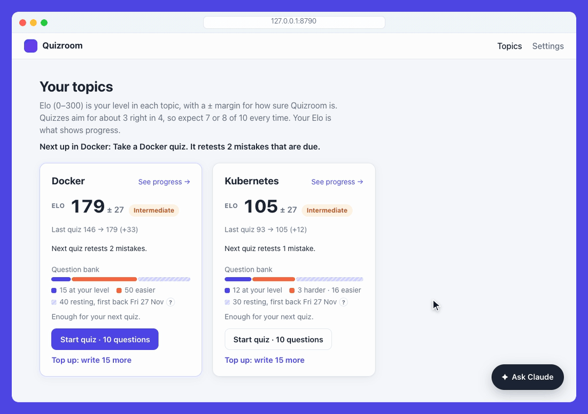
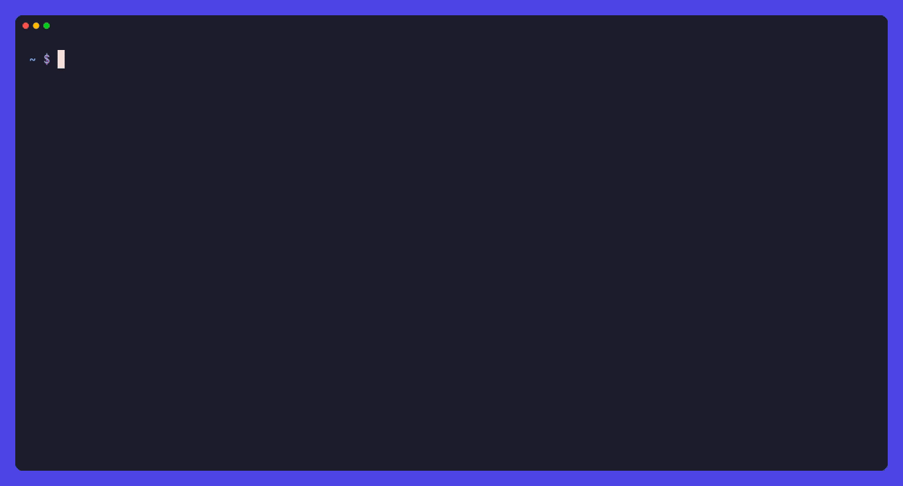
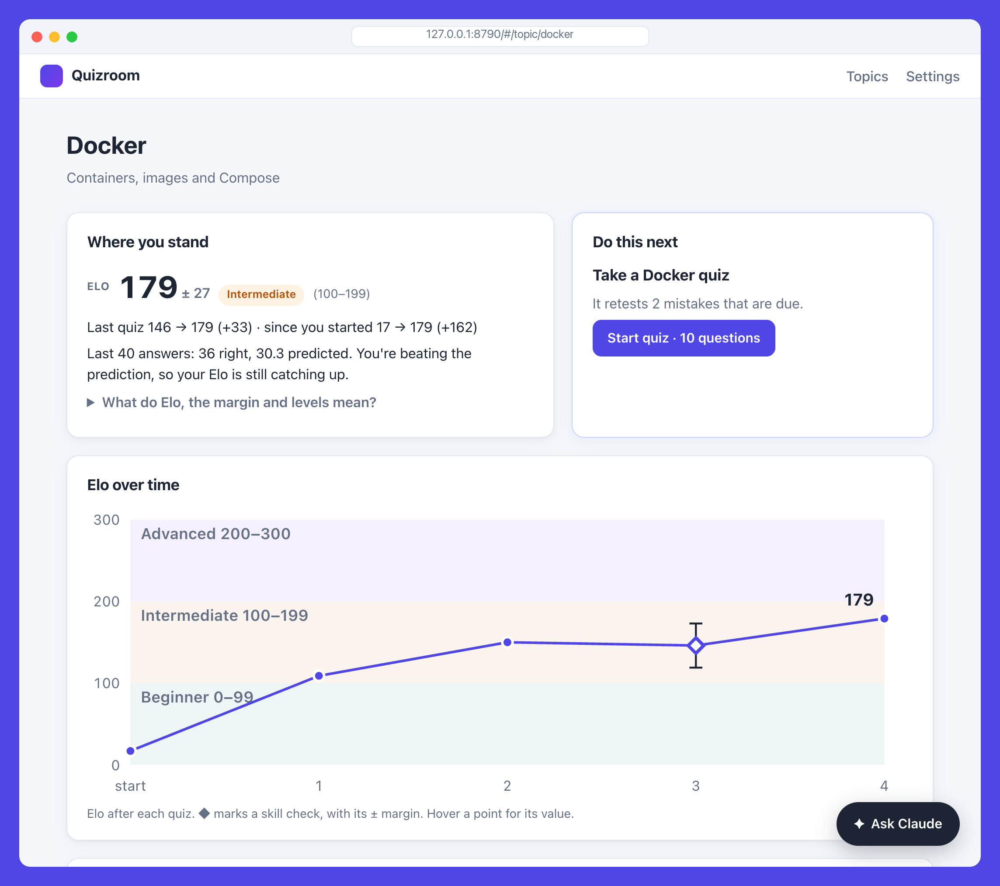

# Quizroom

[](https://github.com/shottah/quizroom/actions/workflows/ci.yml)
[](LICENSE)
[](backend/go.mod)
[](frontend/package.json)
[](frontend/package.json)

Adaptive multiple-choice quizzes on any subject, with questions written for you by Claude. Quizroom runs on your own computer, keeps an Elo rating for each topic, and brings back the mistakes you actually make until you stop making them.



- **Questions at your level.** Each quiz picks questions you have about a 75% chance of getting right, so they get harder as you improve. There are no pass marks.
- **An Elo rating with a margin.** Each topic has an Elo from 0 to 300 (Beginner 0–99, Intermediate 100–199, Advanced 200–300), with a ± margin for how sure Quizroom is. A skill check measures it in 10–20 questions.
- **Your own mistakes.** A wrong answer that matches a known trap goes on your mistake list. It comes back as a new question in your next quiz, then 1, 3, 7 and 21 days after each right answer. Five right in a row and it's done.
- **Any subject.** Docker and Kubernetes are set up on first start. Ask Claude in the chat for another topic, and it plans the subtopics and writes the questions.
- **No spending in the background.** Claude is only called when you send a chat message or ask for questions.

## Quick start

You need:

- Docker with Compose v2 (Docker Desktop, or Docker Engine with the Compose plugin), `make` and `bash`.
- A Claude credential, because a new install has no questions and Claude writes them. Either a Claude subscription, signed in with the [Claude Code CLI](https://code.claude.com/docs) installed on your computer, or an Anthropic API key.

```sh
git clone https://github.com/shottah/quizroom.git
cd quizroom
make token     # or: make api-key
make up
```



Then open http://127.0.0.1:8790 and press **Write my first 30 questions** on a topic. Claude takes a few minutes to write them.

### Which Claude credential?

- **Subscription token (`make token`).** Runs `claude setup-token`, which signs you in through Anthropic's own flow and prints a long-lived token. Quizroom saves it in `.env` (mode 600), and only the runner container ever sees it. Calls count against your plan's usage limits.
- **API key (`make api-key`).** Each call is billed to your Anthropic API account and capped at $1. When both are set, the API key is used.

Anthropic's [legal and compliance terms](https://code.claude.com/docs/en/legal-and-compliance) allow you to sign in to the unmodified Claude Code binary with your own subscription, which is what the runner does. They also say that developers building products on Claude should use API keys, and they don't allow routing other people's requests through your plan. So use your own credential for your own copy, and choose an API key if anyone else uses your instance or if you're unsure.

## Commands

| Command | What it does |
|---|---|
| `make token` | Saves your subscription token to `.env` (mode 600, never echoed) and restarts the runner if it's up |
| `make api-key` | Saves an API key instead. While it's set, Claude calls bill your API account |
| `make up` / `make down` / `make logs` | Start, stop and follow the stack |
| `make doctor` | Checks the containers, the app, and which Claude credential is in use |
| `make test` | Go tests against a throwaway Postgres, then the frontend checks. Never calls Claude |
| `make types` | Regenerates the frontend's API types from the backend's Go types |

## Configuration

- **`.env`** is created from [`.env.example`](.env.example) the first time you run `make token` or `make api-key`. Besides the credential it holds `TZ`, your time zone for day labels and due dates (UTC by default), an optional `POSTGRES_PASSWORD`, and an optional `ALLOWED_HOSTS` for serving Quizroom under a name other than localhost.
- **Settings in the app** choose how hard quizzes are and which Claude model writes questions (Sonnet by default, or Opus).
- **Your data** lives in the `quizroom_pgdata` Docker volume. `make down` keeps it, and `docker compose down -v` deletes it. To back it up, run `docker compose exec -T db pg_dump -U quizroom quizroom > ~/quizroom-backup.sql`.

## How it works

Docker Compose runs four containers:

- `frontend`: nginx serving the React app on 127.0.0.1:8790, the only published port.
- `backend`: the Go API, built with [Huma](https://huma.rocks) and [pgx](https://github.com/jackc/pgx). It talks to `db` and `runner`.
- `db`: Postgres 18.
- `runner`: the Claude Code CLI, run as `claude -p` with no tools, MCP servers or settings. It's the only container that holds the Claude credential, and only the backend can reach it.

Each answer is scored with a three-parameter logistic model: your rating against the question's difficulty, with a floor for lucky guesses. As in Elo, both your rating and the question's move a little after every answer. The ± margin is a Glicko-style rating deviation: it narrows as you answer and widens while you're away.

Each topic has a progress page with your Elo after every quiz, the margin from each skill check, your weak spots and your mistake list.



API formats are defined once, as Go types. The OpenAPI document at http://127.0.0.1:8790/openapi.json is generated from them, and so are the frontend's TypeScript types.

### For AI agents

Two endpoints let an AI agent, such as one running mock interviews with you, work with your progress:

- `GET /api/topics/{slug}/summary` returns your Elo and margin, your weakest subtopics and your active mistakes.
- `POST /api/mistakes` with `"source": "mock"` adds a slip the agent noticed. It comes up in your next quiz.

## Security

Quizroom is a single-user app for your own computer, and it has no login: anyone who can reach port 8790 can use your copy and spend your Claude usage. Compose publishes the port on 127.0.0.1 only. Keep it that way, or put your own authentication in front of it and add its host name to `ALLOWED_HOSTS`.

The API also refuses requests that other websites send from your browser, and any request not addressed to localhost or 127.0.0.1, so a page you visit can't use your copy. To report a vulnerability, see [SECURITY.md](SECURITY.md).

## Contributing

Issues and pull requests are welcome. [CONTRIBUTING.md](CONTRIBUTING.md) covers the development setup, the tests and the project's conventions.

## License

Copyright (C) 2026 Matthew Abraham

Quizroom is free software: you can redistribute it and/or modify it under the terms of the GNU Affero General Public License as published by the Free Software Foundation, either version 3 of the License, or (at your option) any later version. See [LICENSE](LICENSE).

Quizroom isn't affiliated with or endorsed by Anthropic. Claude is a trademark of Anthropic, PBC. The runner image downloads the Claude Code CLI, which isn't open source and is used under Anthropic's terms, so build that image yourself rather than publishing it.
